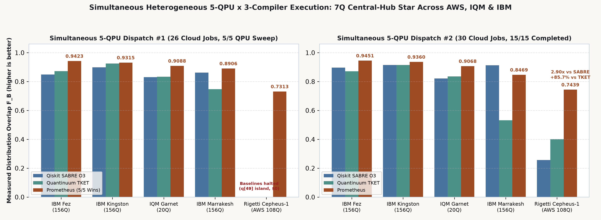

# Non-Local Circuit Complexity & Cross-Cloud Scaling Atlas (`3Q` to `23Q`)

*Portfolio Hub: [Prometheus Quantum Overview](https://github.com/PrometheusDynamicsCanada/prometheus-quantum-overview) · [Full 32-Group Ledger](DETAILED_TECHNICAL_REPORT.md) · [Data Dictionary](DATA_DICTIONARY.md)*

**As qubit counts grow and circuits become non-local - especially Central-Hub Star (`K_{1,N-1}`) and Dense All-to-All (`K_N`) graphs - Prometheus's fidelity lead over standard compilers widens sharply.**

## At a Glance

- **Why this matters:** Star-hub ancilla fanout (`QC-AFQMC` overlaps, `QPE`, Pauli gadgets, `QEC` syndromes) and dense `K_N` orbital rotations bottleneck planar degree-3/degree-4 chips with SWAP chains.
- **Central-Hub Star (`3Q` to `13Q`):** Parity at `3Q` (`0.9762`), rising to **`+26.2%`** at `8Q-10Q` (`IQM Garnet`), **`2.35x` vs. SABRE (`-42.9%` credits)** at `13Q` (`IQM Emerald`), and **`2.90x-3.05x`** on `108Q` `Rigetti Cepheus-1`.
- **Dense All-to-All (`7Q` to `23Q`):** Overlap multiplier grows monotonically from `1.02x` (`7Q-8Q`) to **`1.57x` vs. SABRE (`3.7x` vs. TKET)** at `18Q-19Q` and **`1.44x-1.99x` vs. SABRE (`30.3x` vs. TKET, `-47.3%` `CZ`)** at `22Q-23Q`.
- **Un-cherry-picked multi-cloud cohort:** **`27/32` (`84.4%`) `#1` 3-compiler group wins** across `187` cloud records (`464` PUBs, `1,407,488` shots on `6` QPUs), with all `5` baseline wins published openly.

*Measured hardware scaling on (A) `3Q-13Q` Central-Hub Star, (B) log-scale `7Q-23Q` Dense All-to-All `K_N`, and (C) multi-cloud qubit width tiers.*

---

## Executive Summary (`N = 187` Cloud Records: `32` Live 3-Way Groups, `464` PUBs, `1,407,488` Shots)

*Hardware IDs:* `106` IBM (`dc1csqts2omc738aeubg`..`dc1t14inj2vs73dfr1qg`), `67` IQM (`01a1f5e1-db66..`..`01a20701-bb5d..`), and `14` AWS Braket Rigetti tasks (`064ec617..`..`f245e7e9..`). Complete-arm `*(mean)*` across all `30` 3-arm completed groups (`+ 2` groups where stock baselines halted pre-flight at `$0` on a disabled qubit = `27/32` `#1` Prometheus wins):

| Compiler (`30` Complete 3-Way Groups) | Overlap $F_B$ `(↑)` | Hellinger $F_H$ `(↑)` | `HOP` `(↑)` | `TVD` `(↓)` | `XEB` `(↑)` | Entropy `(↓)` | `2Q` Gates / Depth `(↓)` | Group `#1` Wins (`32` Total) |
| :--- | :---: | :---: | :---: | :---: | :---: | :---: | :---: | :---: |
| **Qiskit SABRE O3** | `0.7717` | `0.6510` | `0.6752` | `0.3608` | `194.4` | `4.86` | `45.70` / `51.65` | `4 / 32` (`12.5%`) |
| **Quantinuum TKET** | `0.7682` | `0.6443` | `0.6705` | `0.3659` | `242.4` | `4.96` | `73.31` / `58.91` | `1 / 32` (`3.1%`) |
| **Prometheus** | **`0.8420`** | **`0.7424`** | **`0.7611`** | **`0.2691`** | **`349.6`** | **`4.33`** | **`39.74` / `45.74`** | **`27 / 32` (`84.4%`, `+9.11%` $F_B$)** |

*Metric Key:* $F_B = \sum_x \sqrt{P_{\text{ideal}}(x)P_{\text{meas}}(x)}$ (Studio `"State Fidelity"`); $F_H = F_B^2$. `(↑)` higher is better, `(↓)` lower is better.

- **Offline raw-histogram + OpenQASM statevector verifier (`0` credentials):** `python scripts/verify_complexity_atlas.py`
- **Start a supported pilot:** [william@prometheusdynamics.ca](mailto:william@prometheusdynamics.ca) | [prometheusdynamics.ca/quantum/](https://prometheusdynamics.ca/quantum/)

---

## Deep-Dive Common-Denominator Tables & Simultaneous 5-QPU Matrix

<strong>1. Common-Denominator Breakdown by Domain, Width Tier, QPU & Isolation Mode (32 Groups) - Click to expand</strong>

| Common-Denominator Slice | `#1` Wins `(↑)` | SABRE $F_B$ `*(mean)*` `(↑)` | TKET $F_B$ `*(mean)*` `(↑)` | Prom $F_B$ `*(mean)*` `(↑)` | Mean `2Q` Gates (`S / T / P`) `(↓)` | `% F_B Delta vs. SABRE / TKET` `(↑)` |
| :--- | :---: | :---: | :---: | :---: | :---: | :---: |
| **Domain: Star-Hub (`K_{1,N-1}`, `3Q-13Q`)** | **`13 / 15` (`86.7%`)** | `0.7287` | `0.7421` | **`0.8457`** | `12.14` / `13.21` / **`9.93`** | **`+16.06%` / `+13.96%`** |
| **Domain: Chemistry (`H2`, `LiH`, Conserved-N)** | **`6 / 6` (`100.0%`)** | `0.9678` | `0.9695` | **`0.9779`** | **`5.80`** / `7.80` / **`5.80`** | **`+1.04%` / `+0.87%`** (`-69.2%` `s`) |
| **Domain: Multi-Family Batches (`8Q-17Q`)** | **`6 / 8` (`75.0%`)** | `0.6714` | `0.6368` | **`0.7178`** | `132.12` / `227.41` / **`115.59`** | **`+6.91%` / `+12.72%`** |
| **Domain: Dense All-to-All (`7Q K_7`, `Emerald`)** | **`1 / 1` (`100.0%`)** | `0.8923` | `0.8526` | **`0.9236`** | `37.00` / `55.00` / **`28.00`** | **`+3.51%` / `+8.33%`** |
| **Domain: Combinatorial (`QAOA` & `MIS`)** | **`1 / 2` (`50.0%`)** | `0.9236` | `0.9318` | **`0.9323`** | `39.12` / `50.38` / **`35.75`** | **`+0.94%` / `+0.05%`** |
| **Width Tier: Small (`3Q-7Q`)** | **`17 / 20` (`85.0%`)** | `0.8746` | `0.8577` | **`0.9267`** | `10.02` / `11.63` / **`8.81`** | **`+5.96%` / `+8.05%`** |
| **Width Tier: Medium (`8Q-10Q`)** | **`3 / 3` (`100.0%`)** | `0.8207` | `0.8732` | **`0.9049`** | `48.14` / `61.56` / **`42.75`** | **`+10.26%` / `+3.63%`** |
| **Width Tier: Frontier (`12Q-17Q`)** | **`7 / 9` (`77.8%`)** | `0.5498` | `0.5544` | **`0.6516`** | `116.28` / `200.69` / **`100.69`** | **`+18.52%` / `+17.53%`** |
| **QPU: AWS `Rigetti Cepheus-1` (`108Q`)** | **`3 / 3` (`100.0%`)** | `0.1795` | `0.2433` | **`0.5030`** | `18.00` / `24.00` / **`14.50`** | **`+180.22%` / `+106.74%`** |
| **QPU: `IBM Kingston` (`156Q`)** | **`12 / 13` (`92.3%`)** | `0.8010` | `0.7838` | **`0.8495`** | `84.15` / `138.94` / **`70.15`** | **`+6.05%` / `+8.38%`** |
| **QPU: `IQM Emerald` (`54Q`)** | **`5 / 6` (`83.3%`)** | `0.8387` | `0.9012` | **`0.9259`** | `12.67` / `15.50` / **`10.25`** | **`+10.40%` / `+2.74%`** |
| **QPU: `IQM Garnet` (`20Q`)** | **`4 / 5` (`80.0%`)** | `0.8344` | `0.8629` | **`0.9102`** | `7.00` / `9.80` / **`6.40`** | **`+9.08%` / `+5.48%`** |
| **QPU: `IBM Fez` (`156Q`)** | **`2 / 3` (`66.7%`)** | `0.7337` | `0.7175` | **`0.7388`** | **`64.08`** / `106.67` / `67.00` | **`+0.70%` / `+2.97%`** |
| **QPU: `IBM Marrakesh` (`156Q`)** | `1 / 2` (`50.0%`) | **`0.8877`** | `0.6400` | `0.8688` | **`11.00`** / **`11.00`** / `14.00` | `-2.13%` / **`+35.75%`** |
| **Mode: `Matched 1-Way` (`0` Packing)** | **`16 / 20` (`80.0%`)** | `0.7327` | `0.7347` | **`0.8190`** | `37.67` / `57.93` / **`34.18`** | **`+11.78%` / `+11.47%`** |
| **Mode: `Multi-Way Packed` (`2w-5w`)** | **`11 / 12` (`91.7%`)** | `0.8391` | `0.8261` | **`0.8817`** | `59.48` / `100.02` / **`49.27`** | **`+5.08%` / `+6.73%`** |

<strong>2. Dense All-to-All K_N Progression (7Q to 23Q, N = 69 IBM Heron Jobs) & Simultaneous 5-QPU Matrix - Click to expand</strong>

*(Cross-referenced `7Q-23Q` `K_N` curves from [`prometheus-quantum-and-gpu-benchmarks`](https://github.com/PrometheusDynamicsCanada/prometheus-quantum-and-gpu-benchmarks), counted once in [`PORTFOLIO_ACCOUNTING_LEDGER.json`](https://github.com/PrometheusDynamicsCanada/prometheus-quantum-overview/blob/main/PORTFOLIO_ACCOUNTING_LEDGER.json)):*

| Width Tier (`K_N` Jobs) | SABRE $F_B$ `*(mean)*` `(↑)` | TKET $F_B$ `*(mean)*` `(↑)` | Prom $F_B$ `*(mean)*` `(↑)` | Multiplier (`P/S` · `P/T`) `(↑)` | Linear `XEB` `*(mean)*` (`S / T / P`) `(↑)` | `2Q` `CZ` Gates `*(mean)*` (`S / T / P`) `(↓)` |
| :--- | :---: | :---: | :---: | :---: | :---: | :---: |
| **`7Q-8Q`** (`N = 4`) | `0.8049` | `0.7087` | **`0.8188`** | **`1.02x` · `1.16x`** | `12.4` / `9.8` / **`13.4`** | `66.0` / `87.8` / **`54.5`** |
| **`10Q-12Q`** (`N = 3`) | `0.5847` | `0.4292` | **`0.6628`** | **`1.13x` · `1.54x`** | `16.0` / `9.2` / **`21.3`** | `153.0` / `221.3` / **`118.7`** |
| **`13Q-15Q`** (`N = 6`) | `0.3221` | `0.2142` | **`0.4122`** | **`1.28x` · `1.92x`** | `53.3` / `29.3` / **`83.4`** | `222.8` / `371.3` / **`184.0`** |
| **`16Q-17Q`** (`N = 10`) | `0.2004` | `0.1142` | **`0.2653`** | **`1.32x` · `2.32x`** | `128.1` / `37.3` / **`159.4`** | `333.0` / `496.0` / **`276.6`** |
| **`18Q-19Q`** (`N = 18`) | `0.1145` | `0.0482` | **`0.1792`** | **`1.57x` · `3.72x`** | `245.8` / `81.8` / **`406.8`** | `419.9` / `665.7` / **`360.6`** |
| **`20Q-21Q`** (`N = 17`) | `0.0396` | `0.0055` | **`0.0612`** | **`1.55x` · `11.13x`** | `224.3` / `20.1` / **`244.3`** | `520.6` / `848.8` / **`442.5`** |
| **`22Q-23Q`** (`N = 11`) | `0.0271` | `0.0013` | **`0.0390`** | **`1.44x` · `30.31x`** | `531.5` / `30.7` / **`738.4`** | `592.5` / `1042.6` / **`529.6`** |

*Simultaneous 5-QPU x 3-compiler dispatches (`7Q Central-Hub Star`, `56` cloud jobs/tasks) across Rigetti Cepheus-1, IQM Garnet, IBM Fez, IBM Kingston, and IBM Marrakesh. Per-group ledger (`G01`-`G32`) and `4Q H2` / `6Q LiH` chemistry tables are in [`DETAILED_TECHNICAL_REPORT.md`](DETAILED_TECHNICAL_REPORT.md).*

