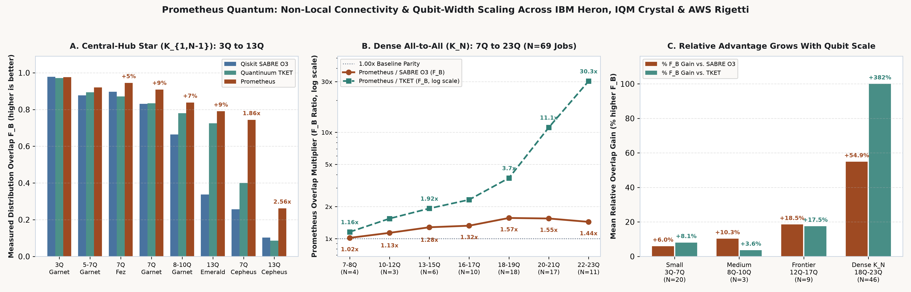

# Non-Local Circuit Complexity & Cross-Cloud Scaling Atlas (`3Q` to `23Q`)

*Explore the portfolio: [Prometheus Quantum Overview](https://github.com/PrometheusDynamicsCanada/prometheus-quantum-overview)*

**As qubit counts grow and interaction graphs become non-local - particularly Central-Hub Star (`K_{1,N-1}`) and Dense All-to-All (`K_N`) circuits - standard compilers suffer compounding SWAP and calibration-hotspot losses while Prometheus's relative fidelity advantage widens monotonically.**

On sparse, narrow circuits (`3Q-6Q` local chains or contiguous pairwise layers), Qiskit SABRE O3, Quantinuum TKET, and Prometheus perform similarly because few routing SWAPs are needed. Once circuit connectivity exceeds native hardware degree (`degree <= 3` on `156Q` IBM Heron Heavy-Hex; `degree <= 4` on `54Q/20Q` IQM Crystal and `108Q` Rigetti Cepheus-1), non-local fanout and all-to-all coupling dominate physical error:

- **Central-Hub Star (`K_{1,N-1}`, `3Q` to `13Q` across `6` cloud QPUs):** Near parity at `3Q` (`0.9762` vs. `0.9782` SABRE), expanding to **`+8.5%` to `+9.0%`** at `7Q` (`IQM Garnet` & `IBM Fez`), **`+26.17%` vs. SABRE (`-36.17%` `2Q` gates vs. TKET)** at `8Q-10Q` (`IQM Garnet`), **`+134.51%` (`2.35x`) vs. SABRE with `-20.0%` to `-42.9%` lower billed credits** at `13Q` (`IQM Emerald`), and **`+85.70%` vs. TKET (`2.90x` vs. SABRE at `7Q`; `3.05x` vs. TKET at `13Q`)** on AWS Braket `Rigetti Cepheus-1-108Q`.
- **Dense All-to-All (`K_N`, `7Q` to `23Q` across `N = 70` matched 3-way QPU runs):** Relative distribution overlap $F_B$ grows from `1.02x` vs. SABRE (`1.16x` vs. TKET) at `7Q-8Q` to **`1.28x` (`1.92x` vs. TKET)** at `13Q-15Q`, **`1.57x` (`3.7x` vs. TKET)** at `18Q-19Q`, and **`1.44x` to `1.99x` vs. SABRE (`11.1x` to `30.3x` vs. TKET, `-47.3%` fewer `CZ` gates)** at `20Q-23Q`.
- **Un-Cherry-Picked Multi-Cloud Cohort (`32` Live 3-Compiler Groups, `187` Unique Cloud Records, `1,407,488` Physical Shots):** Prometheus ranked **`#1` overall on `27/32` (`84.4%`)** live groups (`30/32` [`93.8%`] vs. TKET; `28/32` [`87.5%`] vs. SABRE O3), including **`16/20` wins in `Matched 1-Way` (unpacked) compiler isolation (`+11.78%` mean $F_B$)** and **`11/12` wins in `2`-to-`5`-way spatial packing (up to `-69.23%` lower billed QPU allocation)**. All `5` baseline wins are published in full.

**[Detailed technical tables](DETAILED_TECHNICAL_REPORT.md) · [Data dictionary](DATA_DICTIONARY.md) · [Verify the evidence](#verify-the-evidence)**


*Figure 1: Measured hardware scaling across circuit complexity and qubit count. (A) Central-Hub Star (`K_{1,N-1}`) from `3Q` to `13Q` across IQM Garnet, IBM Fez, IQM Emerald, and AWS Rigetti Cepheus-1. (B) Log-scale relative distribution overlap multiplier (`Prometheus / Baseline`) across `69` matched `7Q-23Q` Dense All-to-All (`K_N`) jobs on `156Q` IBM Heron. (C) Mean relative $F_B$ gain across qubit width tiers (`3Q-7Q` -> `8Q-10Q` -> `12Q-17Q` -> `18Q-23Q`).*

---

## 1. Executive Summary: Common-Denominator Benchmark Tables

*Incremental Primary Corpus:* `N = 187` unique cloud provider records (`186` completed benchmark jobs/tasks + `1` cancelled auxiliary record = `464` physical PUBs and **`1,407,488` physical hardware shots**: `106` IBM Quantum jobs [`dc1csqts2omc738aeubg` .. `dc1t14inj2vs73dfr1qg`], `67` IQM Resonance jobs [`01a1f5e1-db66-7245-9aff-f8c80e4da662` .. `01a20701-bb5d-73e4-b2b7-1ef37925860b`], and `14` AWS Braket `Rigetti Cepheus-1-108Q` tasks [`064ec617-0bca-4f12-b539-99f47d54ae98` .. `f245e7e9-b212-414b-8fdb-a66bd7bcc51f`]). Cross-referenced `7Q-23Q` `Dense All-to-All K_N` curves (`N = 69` jobs) are counted once in [`prometheus-quantum-and-gpu-benchmarks`](https://github.com/PrometheusDynamicsCanada/prometheus-quantum-and-gpu-benchmarks) with zero duplicate IDs in [`PORTFOLIO_ACCOUNTING_LEDGER.json`](https://github.com/PrometheusDynamicsCanada/prometheus-quantum-overview/blob/main/PORTFOLIO_ACCOUNTING_LEDGER.json).

*Metric Conventions:* Classical Bhattacharyya Distribution Overlap is $F_B = \sum_x \sqrt{P_{\text{ideal}}(x) P_{\text{meas}}(x)}$ (labeled `"State Fidelity"` in Studio UIs), kept distinct from Squared Hellinger Fidelity $F_H = F_B^2$. `(↑)` higher is better, `(↓)` lower is better; **bold** marks row winners.

### Table 1A: Common-Denominator Atlas Across Scientific Domains, Width Tiers, Processors & Isolation Modes (`32` Live 3-Way Groups, `1,407,488` Shots)

| Common-Denominator Slice | Groups (`#1` Wins) `(↑)` | Qiskit SABRE O3 $F_B$ `*(mean)*` `(↑)` | Quantinuum TKET $F_B$ `*(mean)*` `(↑)` | Prometheus $F_B$ `*(mean)*` `(↑)` | Mean `2Q` Gates (`SABRE / TKET / Prom`) `(↓)` | `% F_B Delta vs. SABRE / vs. TKET` `(↑)` | `% 2Q Gate Delta vs. SABRE / vs. TKET` `(↓)` |
| :--- | :---: | :---: | :---: | :---: | :---: | :---: | :---: |
| **Domain: Star-Hub & Overlap (`K_{1,N-1}`, `3Q-13Q`)** | **`13 / 15` (`86.7%`)** | `0.7287` | `0.7421` | **`0.8457`** | `12.14` / `13.21` / **`9.93`** | **`+16.06%` / `+13.96%`** | **`-18.20%` / `-24.83%`** |
| **Domain: Quantum Chemistry (`H2`, `LiH`, Conserved-Particle)** | **`6 / 6` (`100.0%`)** | `0.9678` | `0.9695` | **`0.9779`** | **`5.80`** / `7.80` / **`5.80`** | **`+1.04%` / `+0.87%`** (`-69.2%` packed `s`) | `0.00%` / **`-25.64%`** |
| **Domain: Multi-Family Production Batches (`8Q-17Q`)** | **`6 / 8` (`75.0%`)** | `0.6714` | `0.6368` | **`0.7178`** | `132.12` / `227.41` / **`115.59`** | **`+6.91%` / `+12.72%`** | **`-12.51%` / `-49.17%`** |
| **Domain: Dense All-to-All (`7Q K_7`, `IQM Emerald`)** | **`1 / 1` (`100.0%`)** | `0.8923` | `0.8526` | **`0.9236`** | `37.00` / `55.00` / **`28.00`** | **`+3.51%` / `+8.33%`** | **`-24.32%` / `-49.09%`** |
| **Domain: Combinatorial (`QAOA MaxCut` & `MIS`)** | **`1 / 2` (`50.0%`)** | `0.9236` | `0.9318` | **`0.9323`** | `39.12` / `50.38` / **`35.75`** | **`+0.94%` / `+0.05%`** | **`-8.61%` / `-29.04%`** |
| **Width Tier: Small (`3Q-7Q`)** | **`17 / 20` (`85.0%`)** | `0.8746` | `0.8577` | **`0.9267`** | `10.02` / `11.63` / **`8.81`** | **`+5.96%` / `+8.05%`** | **`-12.08%` / `-24.25%`** |
| **Width Tier: Medium (`8Q-10Q`)** | **`3 / 3` (`100.0%`)** | `0.8207` | `0.8732` | **`0.9049`** | `48.14` / `61.56` / **`42.75`** | **`+10.26%` / `+3.63%`** | **`-11.20%` / `-30.56%`** |
| **Width Tier: Frontier (`12Q-17Q`)** | **`7 / 9` (`77.8%`)** | `0.5498` | `0.5544` | **`0.6516`** | `116.28` / `200.69` / **`100.69`** | **`+18.52%` / `+17.53%`** | **`-13.41%` / `-49.83%`** |
| **QPU: AWS `Rigetti Cepheus-1` (`108Q` Square)** | **`3 / 3` (`100.0%`)** | `0.1795` | `0.2433` | **`0.5030`** | `18.00` / `24.00` / **`14.50`** | **`+180.22%` / `+106.74%`** | **`-19.44%` / `-39.58%`** |
| **QPU: `IBM Kingston` (`156Q` Heavy-Hex)** | **`12 / 13` (`92.3%`)** | `0.8010` | `0.7838` | **`0.8495`** | `84.15` / `138.94` / **`70.15`** | **`+6.05%` / `+8.38%`** | **`-16.64%` / `-49.51%`** |
| **QPU: `IQM Emerald` (`54Q` Crystal Square)** | **`5 / 6` (`83.3%`)** | `0.8387` | `0.9012` | **`0.9259`** | `12.67` / `15.50` / **`10.25`** | **`+10.40%` / `+2.74%`** | **`-19.10%` / `-33.87%`** |
| **QPU: `IQM Garnet` (`20Q` Crystal Square)** | **`4 / 5` (`80.0%`)** | `0.8344` | `0.8629` | **`0.9102`** | `7.00` / `9.80` / **`6.40`** | **`+9.08%` / `+5.48%`** | **`-8.57%` / `-34.69%`** |
| **QPU: `IBM Fez` (`156Q` Heavy-Hex)** | **`2 / 3` (`66.7%`)** | `0.7337` | `0.7175` | **`0.7388`** | **`64.08`** / `106.67` / `67.00` | **`+0.70%` / `+2.97%`** | `+4.56%` / **`-37.19%`** |
| **QPU: `IBM Marrakesh` (`156Q` Heavy-Hex)** | `1 / 2` (`50.0%`) | **`0.8877`** | `0.6400` | `0.8688` | **`11.00`** / **`11.00`** / `14.00` | `-2.13%` / **`+35.75%`** | `+27.27%` / `+27.27%` |
| **Mode: `Matched 1-Way` (Pure Compiler, `0` Packing)** | **`16 / 20` (`80.0%`)** | `0.7327` | `0.7347` | **`0.8190`** | `37.67` / `57.93` / **`34.18`** | **`+11.78%` / `+11.47%`** | **`-9.26%` / `-41.00%`** |
| **Mode: `Multi-Way Packed` (`2`-Way to `5`-Way)** | **`11 / 12` (`91.7%`)** | `0.8391` | `0.8261` | **`0.8817`** | `59.48` / `100.02` / **`49.27`** | **`+5.08%` / `+6.73%`** | **`-17.17%` / `-50.74%`** |

---

### Why Dense All-to-All (`K_N`) & Central-Hub Star (`K_{1,N-1}`) Matter Across Quantum Computing

1. **Central-Hub Star (`K_{1,N-1}`):** One ancilla or hub qubit coupled to `N-1` system qubits is the structural core of **Hadamard-test overlap circuits (`QC-AFQMC` trial-wavefunction projection)**, **canonical Quantum Phase Estimation (`QPE`)**, **non-local Jordan-Wigner Pauli exponentials (`exp(-i theta P_1 ... P_k)`)**, and **syndrome / cat-state fanout in Quantum Error Correction (`QEC`)**. On planar degree-3/degree-4 chips, naive routing shuttles the hub linearly across noisy couplers; Prometheus combines fanout-equivalent synthesis with multi-hub island placement to cut both gate count and hotspot exposure.
2. **Dense All-to-All (`K_N`) & Fourier Subroutines (`QFT` / `IQFT`):** Fully coupled interaction graphs arise in **fermionic orbital basis rotations (Givens networks)**, **all-to-all QUBO / portfolio optimization**, and **Quantum Fourier Transforms**. Across `69` matched `7Q-23Q` `IBM Heron` runs (`Table 1B` below), Prometheus cuts native two-qubit `CZ` gates by **`-47.30%` vs. TKET (`-14.24%` vs. SABRE)** while compounding distribution overlap from `1.02x` at `7Q-8Q` to **`1.57x` vs. SABRE (`3.7x` vs. TKET) at `18Q-19Q`** and **`1.99x` vs. SABRE (`91.3x` vs. TKET) at `23Q`**.

### Table 1B: Dense All-to-All (`K_N`) Qubit-Width Progression (`7Q` to `23Q`, `N = 69` Matched 3-Way `IBM Heron` Jobs, `3,317,760` Shots)

| Width Tier (`K_N` Jobs) | Qiskit SABRE O3 $F_B$ `*(mean)*` `(↑)` | Quantinuum TKET $F_B$ `*(mean)*` `(↑)` | Prometheus $F_B$ `*(mean)*` `(↑)` | Overlap Multiplier (`Prom / SABRE` · `Prom / TKET`) `(↑)` | Linear `XEB` `*(mean)*` (`SABRE / TKET / Prom`) `(↑)` | Native `2Q` `CZ` Gates `*(mean)*` (`SABRE / TKET / Prom`) `(↓)` |
| :--- | :---: | :---: | :---: | :---: | :---: | :---: |
| **`7Q-8Q`** (`N = 4` jobs) | `0.8049` | `0.7087` | **`0.8188`** | **`1.02x` · `1.16x`** | `12.4` / `9.8` / **`13.4`** | `66.0` / `87.8` / **`54.5`** (`-17.4%` / `-37.9%`) |
| **`10Q-12Q`** (`N = 3` jobs) | `0.5847` | `0.4292` | **`0.6628`** | **`1.13x` · `1.54x`** | `16.0` / `9.2` / **`21.3`** | `153.0` / `221.3` / **`118.7`** (`-22.4%` / `-46.4%`) |
| **`13Q-15Q`** (`N = 6` jobs) | `0.3221` | `0.2142` | **`0.4122`** | **`1.28x` · `1.92x`** | `53.3` / `29.3` / **`83.4`** | `222.8` / `371.3` / **`184.0`** (`-17.4%` / `-50.4%`) |
| **`16Q-17Q`** (`N = 10` jobs) | `0.2004` | `0.1142` | **`0.2653`** | **`1.32x` · `2.32x`** | `128.1` / `37.3` / **`159.4`** | `333.0` / `496.0` / **`276.6`** (`-16.9%` / `-44.2%`) |
| **`18Q-19Q`** (`N = 18` jobs) | `0.1145` | `0.0482` | **`0.1792`** | **`1.57x` · `3.72x`** | `245.8` / `81.8` / **`406.8`** | `419.9` / `665.7` / **`360.6`** (`-14.1%` / `-45.8%`) |
| **`20Q-21Q`** (`N = 17` jobs) | `0.0396` | `0.0055` | **`0.0612`** | **`1.55x` · `11.13x`** | `224.3` / `20.1` / **`244.3`** | `520.6` / `848.8` / **`442.5`** (`-15.0%` / `-47.9%`) |
| **`22Q-23Q`** (`N = 11` jobs) | `0.0271` | `0.0013` | **`0.0390`** | **`1.44x` · `30.31x`** | `531.5` / `30.7` / **`738.4`** | `592.5` / `1042.6` / **`529.6`** (`-10.6%` / `-49.2%`) |


*Figure 2: Simultaneous heterogeneous `5`-QPU x `3`-compiler dispatches (`7Q Central-Hub Star`) across AWS Braket (`Rigetti Cepheus-1-108Q`), IQM Resonance (`IQM Garnet`), and IBM Quantum (`IBM Fez`, `IBM Kingston`, `IBM Marrakesh`). Left: Dispatch `#1` (`26` cloud jobs, `5/5` QPU win sweep; stock baselines halted at `$0` on `Cepheus-1` when recalibration isolated `q[49]`). Right: Dispatch `#2` (`30` cloud jobs, `15/15` completed arms; `2.90x` vs. SABRE and `+85.7%` vs. TKET on `Cepheus-1`, `0.9451` Fleet `#1` on `IBM Fez`).*

---

## Verify the Evidence

**Verification Kind:** Standalone **raw-histogram distribution overlap ($F_B$) reconstruction from unrouted logical OpenQASM 2.0 circuits**, `187`-record cloud Job-ID / Task-ARN deduplication, shot/PUB accounting, and SHA-256 manifest verification (`0` cloud credentials required):

```bash
python scripts/verify_complexity_atlas.py
```

- **Data & reports:** [`DETAILED_TECHNICAL_REPORT.md`](DETAILED_TECHNICAL_REPORT.md) · [`data/ALL_187_PILOT_CLOUD_JOBS_LEDGER.csv`](data/ALL_187_PILOT_CLOUD_JOBS_LEDGER.csv) · [`data/ALL_32_THREE_WAY_COMPARISONS.csv`](data/ALL_32_THREE_WAY_COMPARISONS.csv) · [`data/COMMON_DENOMINATOR_SUMMARY.json`](data/COMMON_DENOMINATOR_SUMMARY.json) · [`DATA_DICTIONARY.md`](DATA_DICTIONARY.md) · [`PUBLIC_DISCLOSURE.md`](PUBLIC_DISCLOSURE.md)

---

## Discuss a Pilot

**Bring a representative workload and an acceptance criterion. We can compare Prometheus with your existing execution approach across IBM, IQM, and AWS Braket and measure quality, acceptance rate, and charged hardware resources.**

- **Contact:** [william@prometheusdynamics.ca](mailto:william@prometheusdynamics.ca) | [prometheusdynamics.ca](https://prometheusdynamics.ca)
